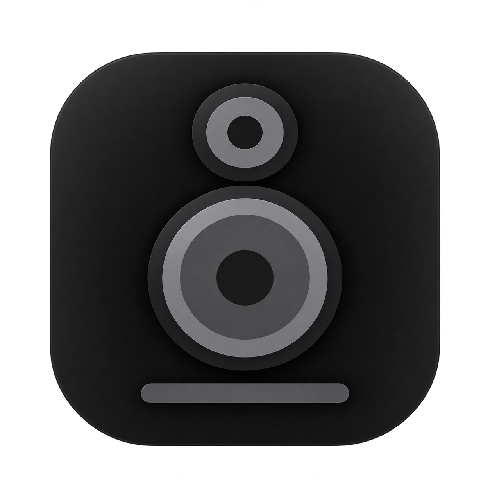
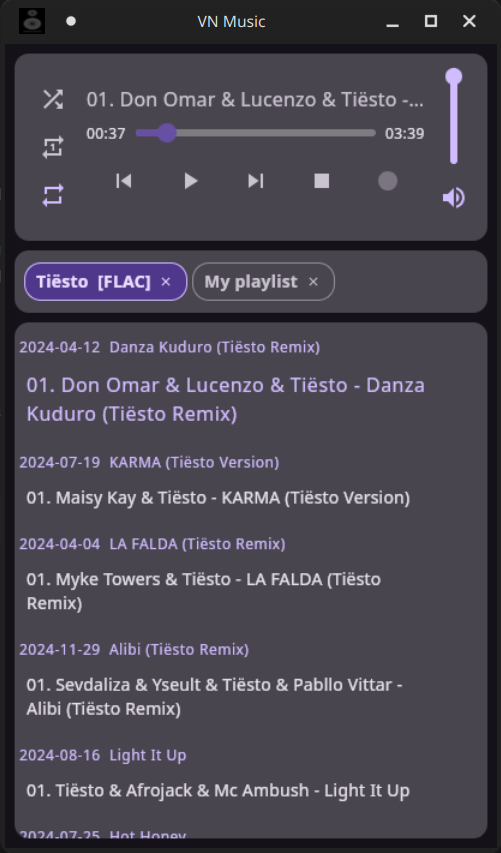

# VN Music



VN Music is a desktop audio player built with Kotlin and Compose Multiplatform. It plays local
MP3, FLAC, OGG, and WAV files, organizes tracks into playlists, and supports Internet radio.
Add files, folders, or radio stream URLs by dragging them into the app.

## Screenshots

| Light theme | Dark theme |
|---|---|
|  |  |

## Get the app

Download a ready-made JAR from the project's **Releases** page when a release is available. If no
release is published yet, build the JAR from the source code using the instructions below. JAR
files are build artifacts and are not stored in the source tree.

The JAR does not include Java. The current build requires Java 21 or newer; Java 8 cannot run it.
Check the Java version with:

```shell
java -version
```

## Build and run from source

Install a compatible JDK, then run these commands from the project root.

### Run the app directly

Linux and macOS:

```shell
./gradlew :composeApp:run
```

Windows:

```powershell
.\gradlew.bat :composeApp:run
```

This is the easiest option for development. Gradle builds the app and runs it on the current
machine.

### Build a self-contained (Uber) JAR

Linux and macOS:

```shell
./gradlew :composeApp:packageUberJarForCurrentOS
```

Windows:

```powershell
.\gradlew.bat :composeApp:packageUberJarForCurrentOS
```

The JAR is written to `composeApp/build/compose/jars/`. Its name includes the target OS and
architecture, for example `io.github.aleksobm.vnmusic-linux-x64-1.0.0.jar`. Run it with:

```shell
java -jar composeApp/build/compose/jars/<jar-file>.jar
```

Build on the target operating system to get the matching artifact. The `packageUberJarForCurrentOS`
task targets the OS where it runs; a JAR built on Linux is not a Windows installer.

### Build a native installer

Native installers bundle a Java runtime and are specific to the target operating system. Build them
on that OS:

| Target | Command |
|---|---|
| Linux (`.deb`) | `./gradlew :composeApp:packageDeb` |
| Windows (`.msi`) | `.\gradlew.bat :composeApp:packageMsi` |
| macOS (`.dmg`) | `./gradlew :composeApp:packageDmg` |

The installer is written under `composeApp/build/compose/binaries/`. Installer packaging and
running it have not been verified on every operating system.

## License

This project is distributed under the MIT License. See [LICENSE.md](LICENSE.md).
